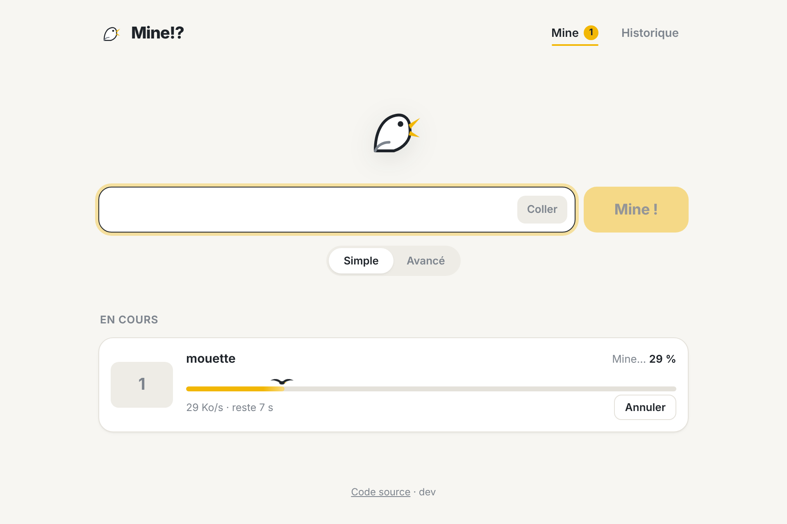

<p align="center"></p>

<h1 align="center">Mine!?</h1>

<p align="center">Tu colles un lien, tu appuies sur <b>Mine !</b>, et le fichier arrive dans ton navigateur.</p>

<p align="center">
  <picture>
    <source media="(prefers-color-scheme: dark)" srcset="docs/mine-dark.png">
    
  </picture>
</p>

Mine!? télécharge des vidéos, de la musique, des sous-titres ou des miniatures depuis YouTube et des centaines d'autres sites (grâce à [yt-dlp](https://github.com/yt-dlp/yt-dlp)), depuis ton Proxmox VE : le serveur télécharge et convertit, puis t'envoie le fichier et l'efface de son côté.

- **Un seul écran** : un champ vide et un bouton. Entrée marche aussi.
- **Options** (sous le champ) : type, format, qualité, codec, dossier, playlist, extrait, sous-titres, cookies et préréglages. Tes choix sont mémorisés dans le navigateur.
- **Historique** : il est gardé dans le navigateur (500 entrées maximum). Tu peux y chercher, filtrer, relancer un téléchargement, copier le lien, ou exporter et importer l'historique en JSON.
- **Suivi en direct** : la mouette s'envole pendant le téléchargement et affiche l'avancement, avec la vitesse et le temps restant pour chaque fichier.
- **Jour et nuit** : automatique, ou au choix avec le bouton soleil/lune (fondu doux), utilisable au téléphone, installable comme une app (menu « Partager » sur Android).

## Installation sur Proxmox VE

Sur l'hôte Proxmox, en root :

```bash
curl -fsSL https://raw.githubusercontent.com/Naod6473/Mine-/main/deploy/install-lxc.sh -o install-lxc.sh
bash install-lxc.sh
```

Le script :

1. crée un LXC Debian 13 non privilégié (1 cœur, 1 Go de RAM, 8 Go de disque, `nesting=1`) ;
2. y monte le dossier `/mnt/mine-downloads` de l'hôte sur `/downloads` (dossier de passage : les fichiers en sortent dès qu'ils sont envoyés au navigateur) ;
3. installe Docker et lance Mine!? ;
4. affiche l'adresse à ouvrir, par exemple `http://192.168.1.50:8081`.

Pour changer un réglage, il suffit de le préciser devant la commande :

```bash
CTID=150 DOWNLOADS=/mnt/data/mine STORAGE=local-zfs IP=192.168.1.50/24 GATEWAY=192.168.1.1 bash install-lxc.sh
```

| Variable | Défaut | Rôle |
| --- | --- | --- |
| `CTID` | prochain ID libre | Numéro du conteneur |
| `DOWNLOADS` | `/mnt/mine-downloads` | Dossier de l'hôte où arrivent les fichiers |
| `STORAGE` | `local-lvm` | Stockage du disque du conteneur |
| `DISK` / `MEMORY` / `CORES` | `8` / `1024` / `1` | Ressources (Go, Mo, cœurs) |
| `BRIDGE` / `IP` / `GATEWAY` | `vmbr0` / `dhcp` / vide | Réseau |
| `PORT` | `8081` | Port de l'interface |

**Mettre à jour :**

```bash
pct exec <CTID> -- bash -c "cd /opt/mine && docker compose pull && docker compose up -d"
```

yt-dlp se met aussi à jour tout seul chaque nuit à 4 h.

> **Image privée ?** L'image est publiée sur `ghcr.io/naod6473/mine` par GitHub Actions. Si le paquet est privé, rends-le public (GitHub → Packages → mine → Package settings), sinon le script construit l'image lui-même depuis le code source.

### Sans le script (Docker Compose)

```bash
docker compose up -d   # avec le compose.yaml de ce dépôt
```

## Réglages du serveur

À mettre dans `environment:` du `compose.yaml` :

| Variable | Défaut | Rôle |
| --- | --- | --- |
| `SEND_TO_BROWSER` | `true` | Envoyer le fichier au navigateur à la fin, puis l'effacer du serveur. `false` pour garder les fichiers sur le serveur |
| `MAX_CONCURRENT_DOWNLOADS` | `3` | Téléchargements en parallèle |
| `OUTPUT_TEMPLATE` | `%(title)s.%(ext)s` | Nom des fichiers ([variables yt-dlp](https://github.com/yt-dlp/yt-dlp#output-template)) |
| `OUTPUT_TEMPLATE_PLAYLIST` | `%(playlist_title)s/%(title)s.%(ext)s` | Nom des fichiers d'une playlist |
| `AUDIO_DOWNLOAD_DIR` | `/downloads` | Dossier séparé pour l'audio |
| `DEFAULT_FOLDER` | vide | Sous-dossier par défaut |
| `CUSTOM_DIRS` / `CREATE_CUSTOM_DIRS` | `true` / `true` | Choix et création de sous-dossiers |
| `CLEAR_COMPLETED_AFTER` | `0` | Secondes avant de retirer un téléchargement terminé de la liste du serveur (0 = jamais). Avec l'envoi au navigateur, un fichier jamais récupéré est effacé à ce moment-là |
| `YTDL_OPTIONS` | `{}` | Options yt-dlp en JSON, par exemple `{"ratelimit": 5000000}` |
| `YTDL_NIGHTLY_UPDATE_TIME` | vide | Heure de mise à jour quotidienne de yt-dlp, par exemple `04:00` |
| `PUID` / `PGID` | `1000` | Utilisateur propriétaire des fichiers |
| `URL_PREFIX` | vide | Préfixe d'URL derrière un reverse proxy, par exemple `/mine/` |
| `ALLOW_PRIVATE_ADDRESSES` | `false` | Autoriser les liens vers ton réseau local |

## Conditions et confidentialité

Les conditions d'utilisation et la page de confidentialité sont dans l'application (liens en bas de page). Elles désignent comme responsable « l'administrateur », c'est-à-dire la personne qui installe l'instance.

## Sécurité

Mine!? n'a pas de mot de passe. Sur ton réseau local, c'est acceptable. Pour y accéder de l'extérieur, passe par ton VPN (WireGuard, Tailscale) ou par un reverse proxy avec authentification, plutôt que d'ouvrir le port 8081 sur Internet.

## Développement

```bash
uv sync && uv run python app/main.py         # serveur sur :8081
cd ui && npm install && npm run dev          # interface sur :5173, relayée vers :8081
uv run pytest -q                             # tests du serveur
cd ui && npm run check && npm run build      # vérification et construction de l'interface
```

- `app/` : le serveur (aiohttp, Socket.IO, yt-dlp) ;
- `ui/` : l'interface (Svelte 5 + Vite) ;
- `deploy/` : le script d'installation pour Proxmox.

## Licence

[GNU AGPL v3.0](LICENSE). Mine!? est un travail dérivé d'un logiciel libre sous la même licence : voir [NOTICE](NOTICE). Si tu proposes l'app à d'autres personnes sur un réseau, le lien « Code source » en bas de page leur donne accès au code, comme la licence l'exige.
